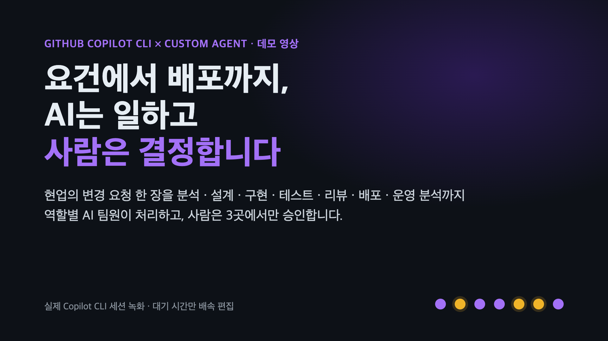

# ghcp_cli_workflow_demo_kit — GitHub Copilot CLI × Custom Agent 데모 키트

> **한국어판 안내입니다.** 영어판(기본)은 저장소 루트의 [`README.md`](README.md) 에 있습니다. 한국어판 산출물(PPTX · 영상 · 샘플 산출물)은 [`ko/`](ko/) 폴더에 있고, 이 문서의 수치는 한국어 녹화본 기준입니다.
> [Releases](https://github.com/junwoojeong100/ghcp_cli_workflow_demo_kit/releases): **v1.0.0** = 한국어판 파일(`GHCP_CLI_Workflow_Demo_KO.pptx` · `GHCP_CLI_Workflow_Demo_KO.mp4` · `ghcp_cli_workflow_video_assets.zip`), **v1.1.0** = 영어판 파일(`GHCP_CLI_Workflow_Demo_EN.pptx` · `GHCP_CLI_Workflow_Demo_EN.mp4` · `ghcp_cli_workflow_video_assets_en.zip`).

> **AI는 일하고, 사람은 결정합니다.**
> 현업의 변경 요청 한 장을 분석 → 설계 → 구현 → 테스트 → 리뷰 → 배포 → 운영 분석까지 역할별 AI 팀원(Custom Agent 7종)이 처리하고,
> 사람은 중요한 3곳(설계 · 코드 · 운영 배포)에서만 승인하는 워크플로우를 **실제 Copilot CLI 세션으로 녹화**했습니다.

## 브라우저에서 바로 보기 — 다운로드 없이

클릭하면 영상이 브라우저에서 바로 재생되고, 슬라이드도 브라우저에서 열립니다(슬라이드 안의 단계별 영상도 재생됩니다).

[](https://junwoojeong100.github.io/ghcp_cli_workflow_demo_kit/ko/video/GHCP_CLI_Workflow_Demo_KO.mp4)

| 항목 | 열기 |
|---|---|
| **전체 영상** (9분 28초, 1080p) | [▶ 브라우저에서 재생](https://junwoojeong100.github.io/ghcp_cli_workflow_demo_kit/ko/video/GHCP_CLI_Workflow_Demo_KO.mp4) |
| **발표 자료** (25장, 단계별 영상 내장) | [📑 브라우저에서 열기](https://view.officeapps.live.com/op/view.aspx?src=https%3A%2F%2Fjunwoojeong100.github.io%2Fghcp_cli_workflow_demo_kit%2Fko%2FGHCP_CLI_Workflow_Demo_KO.pptx) |
| 전체 영상의 **챕터로 바로 이동** | [분석](https://junwoojeong100.github.io/ghcp_cli_workflow_demo_kit/ko/video/GHCP_CLI_Workflow_Demo_KO.mp4#t=4) · [설계](https://junwoojeong100.github.io/ghcp_cli_workflow_demo_kit/ko/video/GHCP_CLI_Workflow_Demo_KO.mp4#t=47.3) · [구현](https://junwoojeong100.github.io/ghcp_cli_workflow_demo_kit/ko/video/GHCP_CLI_Workflow_Demo_KO.mp4#t=124.8) · [테스트](https://junwoojeong100.github.io/ghcp_cli_workflow_demo_kit/ko/video/GHCP_CLI_Workflow_Demo_KO.mp4#t=183.2) · [리뷰](https://junwoojeong100.github.io/ghcp_cli_workflow_demo_kit/ko/video/GHCP_CLI_Workflow_Demo_KO.mp4#t=235.6) · [배포](https://junwoojeong100.github.io/ghcp_cli_workflow_demo_kit/ko/video/GHCP_CLI_Workflow_Demo_KO.mp4#t=287.9) · [운영](https://junwoojeong100.github.io/ghcp_cli_workflow_demo_kit/ko/video/GHCP_CLI_Workflow_Demo_KO.mp4#t=362) · [결과 화면](https://junwoojeong100.github.io/ghcp_cli_workflow_demo_kit/ko/video/GHCP_CLI_Workflow_Demo_KO.mp4#t=472.8) · [안전장치 시연](https://junwoojeong100.github.io/ghcp_cli_workflow_demo_kit/ko/video/GHCP_CLI_Workflow_Demo_KO.mp4#t=490) · [정리](https://junwoojeong100.github.io/ghcp_cli_workflow_demo_kit/ko/video/GHCP_CLI_Workflow_Demo_KO.mp4#t=563) |
| **단계별 클립** (한 단계씩) | [분석 0:41](https://junwoojeong100.github.io/ghcp_cli_workflow_demo_kit/ko/video/clips/01_%EB%B6%84%EC%84%9D.mp4) · [설계 1:18](https://junwoojeong100.github.io/ghcp_cli_workflow_demo_kit/ko/video/clips/02_%EC%84%A4%EA%B3%84.mp4) · [구현 0:58](https://junwoojeong100.github.io/ghcp_cli_workflow_demo_kit/ko/video/clips/03_%EA%B5%AC%ED%98%84.mp4) · [테스트 0:52](https://junwoojeong100.github.io/ghcp_cli_workflow_demo_kit/ko/video/clips/04_%ED%85%8C%EC%8A%A4%ED%8A%B8.mp4) · [리뷰 0:52](https://junwoojeong100.github.io/ghcp_cli_workflow_demo_kit/ko/video/clips/05_%EB%A6%AC%EB%B7%B0.mp4) · [배포 1:14](https://junwoojeong100.github.io/ghcp_cli_workflow_demo_kit/ko/video/clips/06_%EB%B0%B0%ED%8F%AC.mp4) · [운영 1:51](https://junwoojeong100.github.io/ghcp_cli_workflow_demo_kit/ko/video/clips/07_%EC%9A%B4%EC%98%81.mp4) · [안전장치 시연 1:13](https://junwoojeong100.github.io/ghcp_cli_workflow_demo_kit/ko/video/clips/08_%EC%95%88%EC%A0%84%EC%9E%A5%EC%B9%98_%EC%8B%9C%EC%97%B0.mp4) |

영상은 GitHub Pages 로 제공되어 브라우저 내장 플레이어에서 재생됩니다. 슬라이드는 Microsoft 의 PowerPoint 웹 뷰어로 열리며, 슬라이드의 영상에서 ▶ 를 누르면 재생되고, 오른쪽 아래 **NOTES** 에서 발표 스크립트를, **Start Slide Show** 로 전체 화면 발표를 볼 수 있습니다. 뷰어는 자체 글꼴을 쓰므로 일부 줄바꿈이 데스크톱 PowerPoint 와 조금 다를 수 있습니다. 정확한 모양은 PPTX 를 내려받아 확인하세요(아래 안내).

## ghcp_cli_workflow 시리즈 — 2개 저장소를 함께 씁니다

이 데모는 **이름이 `ghcp_cli_workflow` 로 시작하는 두 저장소**로 나뉘어 있습니다. 둘 다 있어야 발표와 시연을 모두 할 수 있습니다.

| 저장소 | 역할 |
|---|---|
| [`ghcp_cli_workflow_demo_kit`](https://github.com/junwoojeong100/ghcp_cli_workflow_demo_kit) (**지금 보는 저장소**) | 발표 키트 — 슬라이드(PPTX) · 영상 · 실제 산출물(`ko/sample-output/`) · 제작 소스(`production-source/`). 한국어판은 `ko/` 폴더, 영어판(기본)은 저장소 루트 |
| [`ghcp_cli_workflow_shopflow_orders`](https://github.com/junwoojeong100/ghcp_cli_workflow_shopflow_orders) | **데모 저장소** — Custom Agent 7종 · Hook · 승인 게이트 · CI/CD 가 들어 있는 시연 대상 앱(ShopFlow). 직접 Copilot CLI 로 같은 흐름을 재현할 때 씁니다. 브랜치는 `main` 하나(영어)이고, 안내 문서만 영어·한국어(`README.md` / `README.ko.md`)로 제공합니다 |

```bash
# 한 폴더에 두 저장소를 받습니다. 키트 도구가 데모 저장소를 '키트 폴더 안의 shopflow-orders' 로 찾기 때문에 폴더 이름을 지정합니다.
git clone https://github.com/junwoojeong100/ghcp_cli_workflow_demo_kit.git
cd ghcp_cli_workflow_demo_kit
git clone https://github.com/junwoojeong100/ghcp_cli_workflow_shopflow_orders.git shopflow-orders
```

- 이 저장소의 `.gitignore` 가 `shopflow-orders/` 를 제외하므로, 안쪽에 clone 해도 서로의 이력이 섞이지 않습니다. 다른 위치에 두려면 환경 변수 `SHOPFLOW_ROOT` 를 지정하세요.
- **한국어 녹화본 재현:** `ko/` 의 한국어 슬라이드·영상·샘플 산출물은 한국어로 동작하는 변형판 앱에서 녹화했고, 그 앱은 브랜치가 아니라 **태그 `baseline-ko`** 로 보존되어 있습니다: `git clone -b baseline-ko https://github.com/junwoojeong100/ghcp_cli_workflow_shopflow_orders.git shopflow-orders`. 한국어 녹화를 그대로 다시 돌릴 때만 필요하며, 데모 저장소의 `main` 은 영어 앱입니다.
- **보기만 하려면** 다운로드가 필요 없습니다. 위의 [브라우저에서 바로 보기](#브라우저에서-바로-보기--다운로드-없이)를 쓰세요.
- **발표만 하려면** 데모 저장소는 필요 없고, 이 저장소의 `ko/GHCP_CLI_Workflow_Demo_KO.pptx` 와 `ko/video/GHCP_CLI_Workflow_Demo_KO.mp4` 만 받으면 됩니다. 저장소 전체를 clone 하면 영어판·한국어판을 함께 담고 있어 약 200MB 이므로, 덜 받으려면 `git clone --depth 1` 을 쓰거나 [Releases](https://github.com/junwoojeong100/ghcp_cli_workflow_demo_kit/releases) 의 같은 파일(한국어판 = v1.0.0, 영어판 = v1.1.0)을 쓰세요.

| 실측 결과 (한 세션) | |
|---|---|
| 요건 → 운영 분석까지 | 실제 약 **38분** (영상은 대기 시간만 배속해 **8분**) |
| 사람의 개입 | **6번** = 승인 3곳 + 설계 단계의 결정 3건 |
| 테스트 | 26 → 82(구현) → **117개** 전부 통과, 커버리지 99% |
| AI 사용량 | 약 **454 AI Credits ≈ $4.5** (1 Credit = $0.01) |

## 1. 구성

| 경로 | 설명 |
|---|---|
| `ko/GHCP_CLI_Workflow_Demo_KO.pptx` | 발표 자료 **25장** (단계별 영상 클립 내장, 발표자 노트에 **구어체 발표 스크립트**·영상 재생 시점·근거 수록) |
| `ko/video/GHCP_CLI_Workflow_Demo_KO.mp4` | 전체 영상 **9분 28초**, 1080p, 챕터 포함 (타이틀 → 7단계 → 결과 화면 → 안전장치 시연 → 정리) |
| `ko/video/clips/` | 단계별 원본 클립 `01_분석` ~ `07_운영`, `08_안전장치_시연` (1920×1080 전체 화면). PPT 에는 이 클립에서 상단 헤더를 잘라 글자를 키운 슬라이드용 클립이 내장되어 있습니다 |
| `ko/video/stills/` | 승인 팝업·결정 장면 등 주요 화면 캡처(PNG) — 다른 자료에 재사용 가능 |
| `ko/sample-output/` | 녹화 세션의 **실제 산출물**: 단계별 문서 01~07, 승인 기록, 감사 로그(231건), 변경 diff, 실측 지표 |
| `production-source/` | 영상·PPT **제작 소스**: 녹화본(cast)으로 영상 다시 만들기, 덱 빌드 스크립트 (`production-source/README.ko.md` 참고). 발표자 노트 원문은 `production-source/deck/ko/notes.md` |
| `GHCP_CLI_Workflow_Demo_EN.pptx` · `video/` · `sample-output/` | **영어판**(기본) 산출물. 별도의 영어 녹화본에서 만든 것이며 수치가 다릅니다. 안내는 [`README.md`](README.md) |
| `shopflow-orders/` | (저장소에는 없음) 위 시리즈 안내처럼 데모 저장소를 이 이름으로 clone 해 두는 자리(한국어 녹화본을 재현하려면 태그 `baseline-ko`) |

한국어판 PPTX · 영상 · 클립은 용량이 커서(합계 약 93MB) clone 이 무겁습니다. **파일만 받으려면** [Releases](https://github.com/junwoojeong100/ghcp_cli_workflow_demo_kit/releases) 의 **v1.0.0** 에서 PPTX · MP4 를 각각 내려받으세요(저장소의 `ko/` 와 같은 파일입니다).

## 2. 슬라이드 구성 (25장)

| 파트 | 슬라이드 | 내용 |
|---|---|---|
| 도입 | 1–2 | 표지, 오늘의 핵심 (빠르게 · 안전하게 · 사람이 결정) |
| PART 1 · Copilot 한눈에 | 3–6 | 진화(제안→대화→에이전트→맞춤), 핵심 기능 6가지, 일하는 곳(Surface), Copilot CLI |
| PART 2 · 데모 준비 | 7–11 | Custom Agent란, 시나리오(CR-2026-014), 전체 흐름, AI 팀원 7명과 권한, 사람이 승인하는 3곳 |
| PART 2 · 데모 | 12–18 | STEP 1~7 (분석·설계·구현·테스트·리뷰·배포·운영) — 슬라이드마다 영상 클립과 실측 수치 |
| PART 2 · 결과 | 19–20 | 변경 전/후 화면, 안전장치 시연(규칙을 모르는 AI도 Hook이 차단) |
| PART 3 · 효과와 안전 | 21–25 | 실측 효과, 6겹의 통제, 역할별 가치, 도입 로드맵(파일럿→표준화→확산), 시작하기·Q&A |

## 3. 발표 진행 가이드

**30분 (권장)**

| 시간 | 진행 | 슬라이드 |
|---|---|---|
| 0–3분 | 오프닝, 오늘의 핵심 | 1–2 |
| 3–8분 | Copilot 한눈에 (기능 · Surface · CLI) | 3–6 |
| 8–13분 | Custom Agent, 시나리오, 흐름, 팀 구성, 승인 3곳 | 7–11 |
| 13–24분 | **영상 데모** — 단계 슬라이드(30초) → 클립 재생(40~110초) → 해설(30초) | 12–18 |
| 24–27분 | 결과 화면, 안전장치 시연 | 19–20 |
| 27–30분 | 효과, 통제, 가치, 로드맵, Q&A | 21–25 |

**15분 압축본**: 슬라이드 1·2·9·11(4분) → 전체 영상 `0:04–8:10`(8분, 챕터 1~7 + 결과 화면) → 슬라이드 21·25(3분).

**라이브 시연을 넣고 싶다면**: 전체 흐름은 실제 30~40분이 걸리므로, 라이브는 **1단계(분석, 약 2.5분)** 또는 **승인 팝업 장면**만 권장합니다.
나머지는 영상으로 보여 주고, 질문이 나오면 [데모 저장소](https://github.com/junwoojeong100/ghcp_cli_workflow_shopflow_orders)`README.ko.md` 의 스크립트로 해당 단계를 보여 줄 수 있습니다.

**진행 팁**
- **발표자 노트는 그대로 읽어도 되는 구어체 스크립트**입니다. 슬라이드 사이가 끊기지 않도록 앞 장면을 받는 말로 이어지고, 영상 슬라이드(12–18, 20)는 `▶ 영상 재생 (약 N초)` 줄을 기준으로 "영상 전 → 재생 → 영상 후" 순서로 읽습니다. `※` 로 시작하는 줄은 출처라 낭독하지 않습니다. 노트를 그대로 읽으면 말하는 시간이 약 26분(말 속도에 따라 24~29분)이고 영상(약 9분)을 더하면 35분 안팎입니다. 30분대 초반에 맞추려면 4·5·6·22·24번처럼 설명이 긴 슬라이드를 한두 문장으로 줄이세요. 노트 원문은 `production-source/deck/ko/notes.md` 이고, 고친 뒤 덱을 다시 빌드하면 PPT에 반영됩니다.
- 영상 하단의 **노란(호박색) 배너**가 사람이 개입하는 순간입니다(안전장치 시연의 빨간 배너는 시스템이 차단한 순간). "여기서 AI가 멈추고 사람에게 묻습니다"를 짚어 주세요.
- 단계 슬라이드는 같은 구성입니다: 왼쪽 = 큰 영상 클립(폭 8.9인치) + 그 아래 "무슨 일이 있었나", 오른쪽 = 에이전트·핵심 수치·소요 시간/AI 사용량·사람의 역할.
- 비기술 청중에게는 슬라이드 12·13·19·20·21만 짚어도 흐름이 전달됩니다. 기술 청중에게는 7·10·11·22를 더 설명하세요.

## 4. 재생·호환 메모

- **PPT 내장 영상은 슬라이드 쇼 모드에서 재생**됩니다(MP4/H.264). 재생이 안 되면 `ko/video/clips/` 의 같은 내용의 클립(전체 화면 버전)을 직접 여세요.
- 발표장이 크거나 뒷자리까지 글자를 보여 줘야 한다면, 영상을 선택하고 **재생(Playback) 탭 → 전체 화면 재생(Play Full Screen)** 을 켜 두면 재생하는 동안 영상이 화면 전체를 채웁니다.
- 영상 챕터는 QuickTime Player · VLC 등에서 목록으로 점프할 수 있습니다.
- 글꼴은 **Apple SD Gothic Neo**(macOS 기본)입니다. Windows 에서는 대체 글꼴로 표시되어 줄바꿈이 달라질 수 있으니 **발표 PC에서 미리 한 번 열어 확인**하세요.
- 슬라이드의 수치는 녹화 세션의 실측값(`production-source/deck/ko/metrics.json` · `facts.json`, 원본은 `ko/sample-output/`)에서 가져왔습니다.

## 5. 정확히 알아 둘 점

- 영상은 **실제 Copilot CLI 세션 녹화**입니다. 에이전트가 일하는 대기 시간만 최대 8배속으로 줄였고, 사람이 결정·승인하는 장면은 1배속입니다. 화면 오른쪽 끝에 늘 보이는 스크롤바 표시만 보기 좋게 지웠고, 그 밖의 터미널 내용은 녹화 그대로입니다.
- 소요 시간·AI 사용량은 **한 번의 녹화 결과**입니다(Copilot CLI 1.0.98, 기본 모델). 모델·요금제·환경에 따라 달라지며, 크레딧이 요금제에 포함되는지는 계약에 따라 다릅니다.
- `staging` / `production` 은 **로컬 포트로 시뮬레이션**했고, 승인 기록(`gate.py`)·Hook(`guard.py`)은 데모용 구현입니다.
  실제 조직에서는 GitHub PR 승인·브랜치 보호·Environments(필수 검토자)·managed settings 로 대응시킬 수 있습니다(저장소 README 6장).
- **안전장치 시연**은 일부러 규칙을 모르는 에이전트(`quick-fixer`)와 저장소 지침 비활성(`--no-custom-instructions`)으로 진행했습니다.
  평소의 에이전트는 이런 요청을 스스로 거절하지만, 안전이 AI의 판단에만 기대지 않는다는 점을 보이기 위한 구성입니다.
- "기존 방식보다 N배 빠르다" 같은 **비교 수치는 넣지 않았습니다.** 비교 기준(기존 리드타임)은 조직마다 달라 고객 파일럿에서 같은 지표로 측정하길 권합니다.
- 모든 데이터·인물·회사는 가상입니다(승인자 "홍길동 책임(운영 담당)" 포함). `ko/sample-output/audit.jsonl` 의 로컬 경로는 `<DEMO_KIT>` 로 치환했습니다.

## 6. 자주 나오는 질문

- **AI가 규칙을 어기면?** → 도구 호출 직전에 Hook 이 검사해 차단합니다(슬라이드 20 영상: 승인 전 코드 수정 · 표준 문서 수정 · `git push` 3건 차단).
- **승인 없이 운영에 배포될 수 있나?** → 운영 배포 명령은 항상 승인 팝업이 뜨고, 배포 스크립트가 코드 승인 기록(지문 일치)과 staging 검증 기록을 다시 확인합니다.
- **비용은?** → 이번 세션은 약 454 크레딧(≈ $4.5)이었습니다. 단계별 사용량은 슬라이드 12–18, 합계는 슬라이드 21에 있습니다.
- **AI 결과를 믿어도 되나?** → 구현·테스트·리뷰 에이전트를 분리하고(권한도 다름), 테스트 117개와 사람의 승인 3곳이 안전망입니다. 사람이 검토·승인한다는 전제는 그대로입니다.

## 7. 더 해 볼 수 있는 것

1. 데모 저장소를 본인 GitHub 조직으로 가져가(fork 또는 template) **PR 승인 · Environments 승인**으로 같은 3곳 승인을 실제 환경처럼 재현 (데모 저장소 README 6장의 안내 참고)
2. 조직 **managed settings** 로 deny/ask/allow 규칙·샌드박스·MCP 허용목록을 전사에 적용
3. Copilot **OpenTelemetry** 모니터링으로 세션·도구 호출·사용량을 지표화 (슬라이드 24 "측정 지표")
